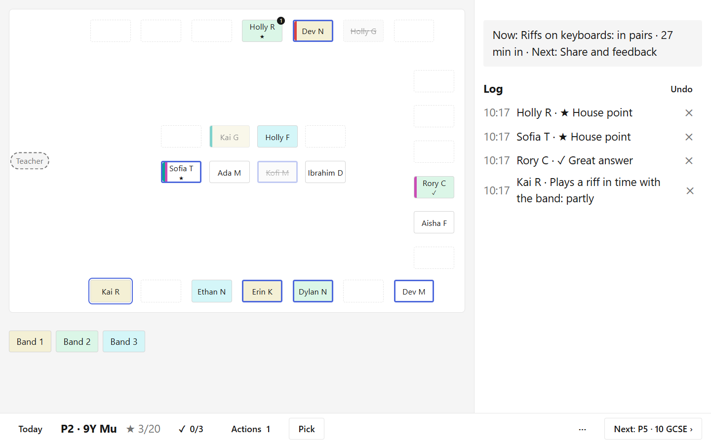

# Downbeat

A personal classroom app for a secondary music teacher: seating plans, two-tap notes, lesson plans that carry forward, criteria-based observations and, later, report export. Django runs on the teacher's laptop and holds the only copy of the data; an offline-first PWA on an iPad is the in-room screen. Pupil data never leaves the teacher's own devices.

Everything runs at one of three tempos: **Plan** (desk, before), **Catch** (in the room, during) and **Sweep** (desk, same day, two minutes).



## Quick start

```
py -3.12 -m venv .venv
.venv\Scripts\python -m pip install -r requirements.txt
.\tools\serve.ps1
```

Open http://127.0.0.1:8000 and follow the first-run setup. To try it with an invented school instead, see [Demo data](docs/DEVELOPMENT.md#demo-data).

## Documentation

| Read this | For |
| --- | --- |
| [docs/USER_STORIES.md](docs/USER_STORIES.md) | What the app does and for whom: user stories with MoSCoW priorities and BDD acceptance scenarios |
| [docs/SCREENSHOTS.md](docs/SCREENSHOTS.md) | The user journeys and key features, shown screen by screen |
| [docs/BUILD_ORDER.md](docs/BUILD_ORDER.md) | The specification: purpose, data model, the six phases and the rules the build must not break |
| [docs/UX.md](docs/UX.md) | Navigation, user journeys, page inventory and the room view's layout |
| [docs/ARCHITECTURE.md](docs/ARCHITECTURE.md) | How it fits together: apps, the gate, the offline queue and sync, the seating solver |
| [docs/OPERATIONS.md](docs/OPERATIONS.md) | Running it day to day: the server, the iPad, backups, restore, export and delete |
| [docs/TAILSCALE.md](docs/TAILSCALE.md) | Step by step: reaching the laptop from the iPad over HTTPS |
| [docs/DEVELOPMENT.md](docs/DEVELOPMENT.md) | Working on the code: setup, demo data, conventions, theme, commits |
| [docs/TESTING.md](docs/TESTING.md) | The test strategy, how to run the suite, what each file covers, browser and device checks |
| [docs/DEVLOG.md](docs/DEVLOG.md) | The development log: what was built in each step, what went wrong and what was learnt |
| [docs/DECISIONS.md](docs/DECISIONS.md) | Every choice the spec didn't settle, dated, with its reasoning |

## Status

Phases 1 to 4 are complete. Phase 5 (assessment) is in progress: the assessment frame, observations from the seat, hinge checks and feedback are built; the exemplar bank and each pupil's timeline are next. See [docs/DEVLOG.md](docs/DEVLOG.md).
